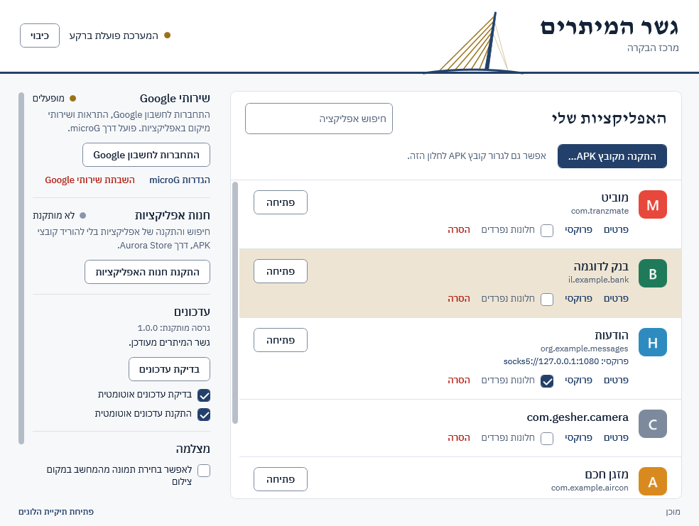
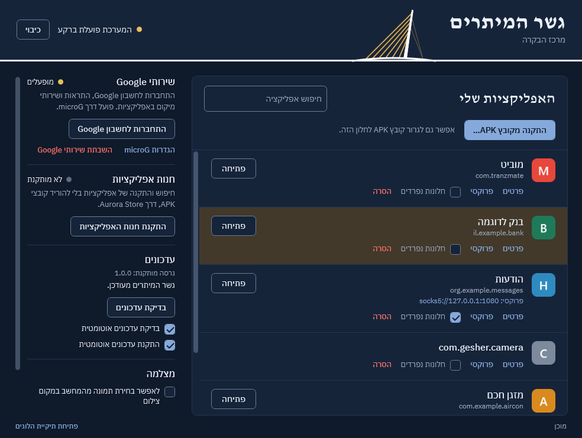
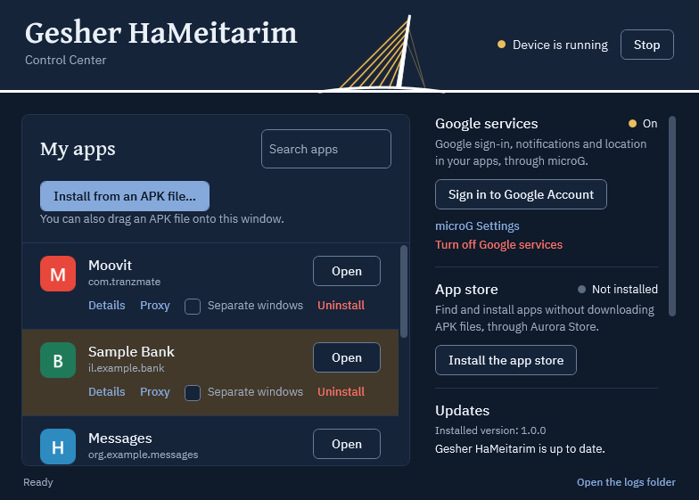
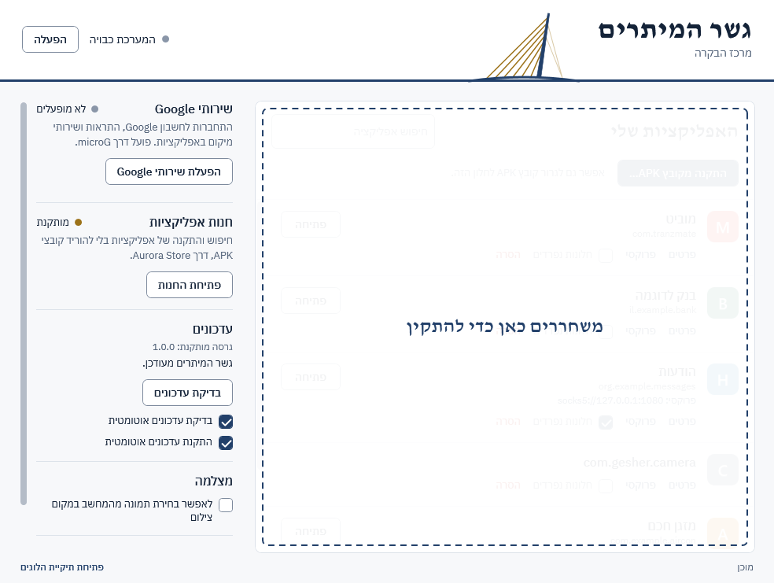
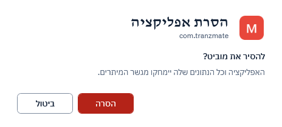
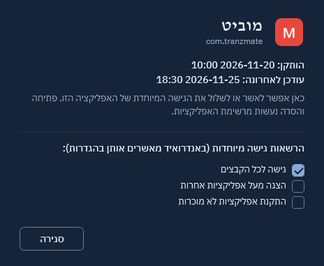
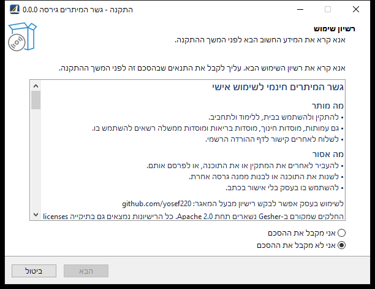
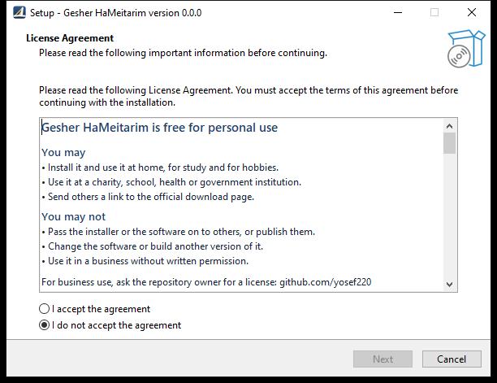

# תוכנית העיצוב — גשר המיתרים

> נכתבה לפי סקיל העיצוב (`.claude/skills/frontend-design`): תוכנית, בדיקה מול התדריך, בנייה, וביקורת עם צילומי מסך.

## התדריך

- **המוצר:** גשר המיתרים. מריץ אפליקציות אנדרואיד על Windows כחלונות רגילים.
- **הקהל:** ישראלים לא טכניים, עברית קודם, הרבה מהם ברשתות מסוננות (נטפרי, אתרוג). אנשים שצריכים את אפליקציית הבנק, מוביט, וואטסאפ, המזגן או המוזיקה שלהם על המחשב.
- **התפקיד העיקרי:** להתקין ולהפעיל אפליקציה בביטחון, ולהבין במילים פשוטות מה קרה כשמשהו לא עבד.
- **מקור השפה החזותית:** גשר המיתרים בירושלים. תורן לבן ונטוי, וכבלים שנפרשים ממנו כמו מיתרי הכינור של דוד המלך, באור הזהוב של ירושלים. המיתרים הם גם הרעיון של המוצר: חוטים מתוחים שמחברים שני עולמות.

## צבעים

| שם | ערך | תפקיד |
|---|---|---|
| שמי ירושלים | `#22406A` | צבע המותג: פס הכותרת, כפתור ראשי, קישורים. כחול עמוק של שחר, לא כחול Windows |
| זהב ירושלים | `#D9A43B` | **המיתרים בלבד**: באייקון, בפס הכותרת ובמסך הפתיחה, ועוד סימון "פעיל". לא לטקסט (ניגודיות נמוכה על לבן) |
| כבל | `#F7F8FA` | משטח בהיר ראשי, לבן קריר של הפלדה |
| אבן | `#EDE4D3` | משטח חם משני, רק לבחירה ולהדגשה. לא רקע |
| פלדה | `#55657B` | טקסט משני, קווים ומסגרות. כוילה מ-`#5A6A80` כדי לעבור 4.5:1 גם על שורה נבחרת (אבן) |
| דיו | `#142338` | טקסט ראשי. במצב כהה הרקע הוא `#0F1A2B` (כחול-לילה, לא שחור אפור) |

**ניגודיות:** דיו על כבל, ולבן על שמי ירושלים, מעל 8:1. זהב ירושלים משמש רק לקישוט, לעולם לא כטקסט על רקע בהיר. **למיתרים ולנקודת "פועלת" על רקע בהיר משמש זהב עמוק, `#9C7219` ‏(4.1:1)**, כי `#D9A43B` נותן שם רק 2.1:1. במצב ניגודיות גבוהה של Windows הכל עובר לצבעי המערכת.

**המקור:** כל הערכים, כולל המצב הכהה, נמצאים ב-[`ui/tokens.json`](../../../ui/tokens.json). המחולל בודק בכל הפקה 21 זוגות ניגודיות בשני המצבים.

## גופנים

| גופן | תפקיד | למה דווקא הוא |
|---|---|---|
| **David Libre** | סימן המילים, כותרות מסכים, מסך הפתיחה | גרסה חופשית (OFL) של "דוד", הגופן העברי הקלאסי של ישמעאל דוד. דוד הוא גם בעל הכינור שהמיתרים שלו נתנו לגשר את שמו |
| **IBM Plex Sans Hebrew** | כל טקסט הממשק | גופן מהונדס ומדויק, כמו גשר. קריא מאוד בעברית בגדלים קטנים, ומטפל טוב בשמות חבילות לועזיים |

- **גיבוי:** Segoe UI, שתומך בעברית בכל Windows. המתקין (Inno Setup) משתמש בו תמיד, כי Inno לא מאפשר גופן מוטמע.
- **התקנה:** הגופנים יושבים ב-`tools/package/ui-fonts` ומותקנים ל-`{app}\ui-fonts`. כל תוכנה טוענת אותם לתהליך שלה בלבד, בלי להתקין גופן במערכת. ב-GDI משקל Medium הוא משפחה נפרדת (`David Libre Medium`), וב-WPF הוא משקל 500 של `David Libre`. הטוקנים שומרים את שני השמות, והמחולל בודק אותם מול הקובץ.
- **סולם (לפי Bringhurst):** 12 להערות, 14 לגוף, 16 לכותרות רשימה, 21 לכותרות אזור, 24 לכותרת מסך (David), 36 או 48 לסימן המילים.
- **שורה:** 1.5 לגוף. אורך שורה עד כ-70 תווים.

## פריסה

**עיקרון:** מימין לשמאל כבסיס. הטקסט מיושר לימין. שמות חבילות, נתיבים ומספרי גרסה מבודדים משמאל לימין.

### מרכז הבקרה (נבנה ב-26.11)

**התפקיד:** לראות את האפליקציות, לפתוח אותן ולהתקין חדשות. כל השאר (שירותי Google, חנות, עדכונים, מצלמה, רשת) הוא מערכת שמגדירים פעם אחת ונוגעים בה לעתים רחוקות, ולכן הוא יושב בצד ובשקט.

```
┌──────────────────────────────────────────────────────────────────────────┐
│ [כיבוי]  ● המערכת פועלת ברקע                ╱│        גשר המיתרים       │  ← הכותרת היא הגשר
│                                         ╱╱╱╱╱ │        מרכז הבקרה        │
│━━━━━━━━━━━━━━━━━━━━━━━━━━━━━━━━━━━━━━━━━━⌒⌒⌒⌒⌒⌒⌒⌒━━━━━━━━━━━━━━━━━━━━━━━━│  ← המסלול הוא הקו התחתון
│                                                                          │
│  שירותי Google      ● מופעלים   ┌──────────────────────────────────────┐ │
│  התחברות, התראות ומיקום          │ [ חיפוש אפליקציה ]      האפליקציות שלי │ │
│  [התחברות לחשבון Google]        │   אפשר גם לגרור לכאן  [התקנה מקובץ APK] │ │
│  הגדרות microG    השבתה          ├──────────────────────────────────────┤ │
│  ─────────────                  │ [פתיחה]                  מוביט  [סמל] │ │
│  חנות אפליקציות  ● לא מותקנת     │                  com.tranzmate        │ │
│  [התקנת חנות האפליקציות]         │   הסרה  ☐ חלונות נפרדים  פרוקסי  פרטים │ │
│  ─────────────                  ├──────────────────────────────────────┤ │
│  עדכונים                        │ …                                     │ │
│  ─────────────                  │                                       │ │
│  מצלמה ・ רשת                    └──────────────────────────────────────┘ │
│ פתיחת תיקיית הלוגים                                                  מוכן │
└──────────────────────────────────────────────────────────────────────────┘
```

- **הכותרת היא הגשר.** סימן המילים ב-David Libre, והגשר לידו. המסלול של הגשר ממשיך לכל רוחב החלון ונהיה הקו שסוגר את הכותרת, עם קשת עדינה מתחת לתורן. זה המקום היחיד שבו העיצוב בולט.
- **זהב פירושו "מחובר".** נקודה זהובה ומשפט פשוט לצידה, באותה שפה לכל מה שיכול לפעול: המערכת, שירותי Google וחנות האפליקציות. נקודה אפורה פירושה כבוי. אין תוויות צבעוניות.
- **שני אזורים, לא ערימת כרטיסים.** "האפליקציות שלי" הוא הלוח היחיד שיש לו מסגרת (משטח מוגבה, רדיוס 8), כי הוא גם אזור הגרירה. העמודה של המערכת יושבת ישירות על המשטח, וקו דק מפריד בין נושאים.
- **פעולה ראשית אחת על המסך:** "התקנה מקובץ APK". בשורה של אפליקציה הכפתור היחיד הוא "פתיחה". "פרטים", "פרוקסי" ו"הסרה" הם קישורי טקסט שקטים, והסרה באדום רק כטקסט. האדום המלא שמור לאישור בדיאלוג.
- **בחירה:** הרשימה היא ListBox. כשאפליקציה מבקשת לפתוח את ההגדרות שלה, השורה שלה נבחרת (רקע אבן) והרשימה גוללת אליה. במקלדת עוברים בין השורות בחצים.
- **חיפוש** מסנן לפי שם או לפי שם החבילה. אם אין תוצאה, הרשימה אומרת את זה. רשימה ריקה מזמינה להתקין.
- **גרירה:** כשגוררים קובץ מעל החלון, הלוח של האפליקציות מקבל מסגרת מקווקוות ואומר "משחררים כאן כדי להתקין". זו התנועה היחידה, והיא תגובה לפעולה של המשתמש.
- **פינות לפי תפקיד:** לוח 8, כפתור 6, תיבת סימון 4, נקודת מצב עגולה לגמרי.
- **מצבים:** בהיר, כהה (לפי ההגדרה של Windows לאפליקציות) וניגודיות גבוהה (צבעי המערכת בלבד). הגופנים נטענים מ-`ui-fonts` לתהליך בלבד, ובלעדיהם הכל נכתב ב-Segoe UI.

**מה שבתוכנית הקודמת ולא נכנס עכשיו, ולמה:** לשוניות תחתונות ל"רשת", "מצב המערכת" ו"רופא ההפעלה". שני האחרונים עוד לא קיימים, ולשונית ריקה הייתה מבטיחה משהו שאין. "רשת" נכנסה לעמודת המערכת. לוח פרטים קבוע לאפליקציה נבחרת נדחה גם הוא: הפרטים וההרשאות המיוחדות נפתחים בדיאלוג "פרטים" הקיים.

**בדיקה מול התדריך:**

| טיוטה ראשונה | למה היא גנרית | התיקון |
|---|---|---|
| העיצוב הקיים: חמישה כרטיסים לבנים זהים, צל ורדיוס אחידים | ערכת הכרטיסים של SaaS | שני אזורים בלבד, ומסגרת רק לרשימה |
| תוויות מצב ירוקות ואפורות ("מופעלים ופעילים") | תגית סטטוס של כל לוח בקרה | נקודה זהובה, הצבע של המיתרים: מה שמחובר נמתח |
| ששה כפתורים במסגרת בכל שורה, ושלושה כפתורים כחולים מלאים במסך | מרק כפתורים, בלי היררכיה | כפתור אחד לשורה, קישורי טקסט, ופעולה ראשית אחת |
| כותרת עם לוגו משמאל וסטטוס מימין | הכותרת של כל אפליקציה | המסלול של הגשר הוא הקו של הכותרת |
| לשוניות "הגדרות" ו"אפליקציות" | מסתיר את העדכונים, ולשונית שמבטיחה כלים שלא נבנו | עמודה צדדית שקטה שתמיד גלויה |

**הביקורת עם צילומים.** הצילומים מצוירים על Windows עם ה-XAML של המוצר (`tools/ui/control-center-preview.ps1`, המשימה "מרכז הבקרה על Windows" ב-`hameitarim-design.yml`), עם נתוני דוגמה ובלי הסמלים האמיתיים של האפליקציות. מה שתוקן בעקבותיהם:

| סבב | מה נראה בצילום | התיקון |
|---|---|---|
| 1 | החלון לא נטען: הצבעים שעל `Window` עצמו נקראים לפני `Window.Resources` | ‏`DynamicResource` בתכונות של החלון |
| 2 | במצב כהה השם בשורה הנבחרת נכתב בשחור על חום | צבע טקסט מפורש לשורה, גם כשהיא נבחרת |
| 2 | ברוחב 800 "האפליקציות שלי" נשבר לשתי שורות, ובאנגלית "Uninstall" ירד שורה | החיפוש מתכווץ, העמודה של המערכת צרה יותר (272), ופחות מרווח בין הפעולות |
| 2 | העמודה של המערכת ארוכה מהחלון, והמצלמה נחתכה | קווים מפרידים צמודים יותר, וגלילה בעמודה עצמה |
| 3 | בחלון רחב החיפוש נשאר צר | עמודה משלו, בין 120 ל-220 |

| עברית, בהיר | עברית, כהה |
|---|---|
|  |  |

| אנגלית, כהה, בגודל המינימלי | גרירה של קובץ APK |
|---|---|
|  |  |

| הסרה | פרטי אפליקציה וגישה מיוחדת |
|---|---|
|  |  |

כל הצילומים, כולל ניגודיות גבוהה, רשימה ריקה, חיפוש בלי תוצאה, הודעה ופרוקסי, נמצאים ב-[`assets/control-center`](assets/control-center).

**מה לא נבדק בצילומים:** ערכת ניגודיות גבוהה אמיתית (המכונה של ה-CI לא במצב הזה, ולכן הצילום מראה את צבעי המערכת של הערכה הרגילה), ‏DPI גבוה, קורא מסך, ואירועי גרירה וחיפוש בחלון חי: כלי הצילום קובע את המצבים האלה ישירות. בדיקות החוזה של מרכז הבקרה (תצוגה בשלושת המצבים ובשתי השפות, 1000 אפליקציות עם וירטואליזציה, עדכונים בגודל המינימלי, גישה מיוחדת, פרוקסי והדיאלוגים) עברו על Windows PowerShell 5.1 באותה משימה.

### מסך הפתיחה (נבנה ב-25.11)

```
┌───────────────────────────────┐
│                               │
│          [אייקון מוביט]         │  ← האפליקציה שהמשתמש לחץ עליה
│             מוביט              │  ← David Libre Medium, 24
│            נפתחת…              │  ← מה קורה, Plex 14, פלדה
│                               │
│                  │╲            │
│           ╱╱╱╱╱╱ │ ╲           │  ← הגשר כקו אופק: המיתרים נמתחים אחד אחד
│   ═══════════════════════     │     (התנועה היחידה במוצר)
└───────────────────────────────┘
```

- **מה מוצג קודם:** האפליקציה, כי המשתמש לחץ על מוביט ולא על גשר המיתרים. הגשר מתחת הוא המחוון והחתימה, ואין סימן מילים.
- **שתי גרסאות נבדקו באב-טיפוס:** (א) הגשר כמחוון קטן מתחת לשם, ו-(ב) הגשר כקו אופק בתחתית. גרסה א נראתה כמו סמל טעינה מקושט. בגרסה ב, בחלון רחב, הגשר כיסה את האפליקציה, ולכן הגובה שלו מוגבל ל-28% מהחלון והוא ממורכז.
- **התנועה:** המיתרים נמתחים מהתורן אל המסלול, אחד כל 140 אלפיות שנייה, נשארים 0.7 שנייה ונאספים בסדר הפוך. מחזור של 2.5 שניות.
- **מצבים:** בהיר; כהה, עם זוהר זהוב עדין על המיתרים; ניגודיות גבוהה, בצבעי המערכת בלבד; הפחתת תנועה, שבה המיתרים מלאים ובלי תנועה. צבע הכותרת של החלון לפי המצב.
- **מימוש:** ‏`compat/shell/splash_paint.cc`, ב-GDI+ עם קווים חלקים וציור ל-bitmap בזיכרון. בלי GDI+ נשאר הציור הקודם, כך שההפעלה לא תלויה בעיצוב. הצילומים על Windows נוצרים ב-CI (`hameitarim-design.yml`).

**הצילומים מ-Windows** (מצוירים ב-CI עם אותו קוד של המוצר):

| מצבים: בהיר, כהה, צבעי המערכת, אנגלית | התנועה: 0.2, ‏0.48, ‏0.82, ‏1.3 ו-2 שניות |
|---|---|
|  |  |


### דיאלוגים (הרשאה, מידע, קריסה)

כותרת ב-David Libre, הסבר קצר ב-Plex, ופעולה ראשית אחת ברורה. בהרשאה: "לאפשר מיקום" / "לא לאפשר". בקריסה: מה קרה, ומה עושים עכשיו.

## עקרונות

1. **עברית היא הבסיס,** ולא תרגום של ממשק אנגלי.
2. **בולטות במקום אחד:** מוטיב המיתרים מופיע באייקון, בפס הכותרת ובמסך הפתיחה, ובשום מקום אחר.
3. **שקט ומבנה:** רשימות ולא כרטיסים. קו מפריד רק כשהוא מפריד משמעות.
4. **אמת במצבים:** כל מצב אומר מה קורה ומה הצעד הבא. בלי "אופס", ובלי הודעה מעורפלת.
5. **שייכות ל-Windows:** מצב בהיר וכהה לפי Windows, ניגודיות גבוהה, מקלדת, ‏DPI, וכיבוד "הפחתת תנועה".

## בדיקה מול התדריך: מה תוקן ולמה

| טיוטה ראשונה | למה היא גנרית | התיקון |
|---|---|---|
| סגנון Fluent של Windows 11, ‏Segoe UI וצבע ההדגשה של המערכת | ככה נראית כל אפליקציה ב-Windows, וגם העיצוב הנוכחי (`#1570EF`) | גופנים עם סיבה (דוד, Plex), צבע מותג משלנו ומוטיב המיתרים |
| כחול כהה וזהב כצבעי ממשק | נראה כמו בנק או מותג יוקרה | הזהב מופיע רק כ"אור על המיתרים". הממשק עצמו לבן קריר ודיו |
| רשת כרטיסים של אפליקציות (כמו בעיצוב של Lev-Good) | ערכת הכרטיסים של SaaS: רדיוס אחיד וצל אחיד | שורות ברשימה ולוח פרטים, ו"פינות לפי תפקיד" |
| שורת תיאור מתחת לשם, עם מקף ארוך | אחד מסממני התבנית הגנרית | סימן מילים נקי. ההסבר מופיע רק במסך הריק של ההפעלה הראשונה |
| שורת סטטוס עם נקודות אמצע בין פריטים | סממן תבנית | כל נתון בשורה משלו, או לשוניות של ממש |
| מסך פתיחה עם הגשר כמחוון קטן מתחת לשם האפליקציה | נראה כמו סמל טעינה מקושט, כמו בכל אפליקציה | הגשר כקו אופק בתחתית החלון, בגובה מוגבל |


## דף הרישיון במתקין (26.11.2026)

**התפקיד:** מי שמתקין מבין תוך עשר שניות מה מותר, ומסכים. הנוסח המחייב נמצא מתחת, למי שרוצה.

- **תוכן:** שורה פותחת, ואחריה "מה מותר" ו"מה אסור". אלה שתי קבוצות אמיתיות של תוכן, ולכן הכותרות הן מידע ולא קישוט. אחריהן איך מבקשים רישיון לעסק, מה נשאר תחת Apache, ושורה שאומרת שזה תקציר. בסוף בא הנוסח המחייב מ-`LICENSE`, משמאל לימין. תחת "מותר" יש גם "לשלוח לאחרים קישור לדף ההורדה הרשמי", כדי שמי שרוצה לשתף יידע מה כן לעשות.
- **צבע:** דיו לגוף, שמי ירושלים לשורה הפותחת ולכותרות, ופלדה לנוסח המשפטי ולשורת התקציר. בלי זהב.
- **גופן:** Segoe UI, כי Inno לא מאפשר גופן מוטמע. הגוף בגודל 9 כמו הטקסט של האשף, השורה הפותחת 11, הכותרות 9.5, והנוסח המשפטי 8.5.
- **הבדיקה מול התדריך:** תבנית רגילה מציגה רק את הנוסח המשפטי. כאן התקציר בעברית פשוטה בא קודם. "מה אסור" לא צבוע באדום, כי אדום מבהיל ולא מתאים לתוכן. שתי הכותרות באותו צבע. הניסוח בלי פנייה בזכר או בנקבה.
- **הביקורת עם צילומים:** בצילום הראשון השורה על שימוש בעסק נחתכה מתחת לחלק הגלוי, והגופן היה גדול מהטקסט של האשף. שניהם תוקנו, ועכשיו כל התקציר נראה בלי גלילה, בשתי השפות.
- **מה נשאר:** הכותרת והשורות מעל התיבה, והבחירה "אני מקבל את ההסכם", מגיעות מקובץ העברית הרגיל של Inno, שפונה בזכר. כך כתוב בכל דפי המתקין, ולכן הם ישתנו יחד, בעיצוב מחדש של המתקין.
- **הקבצים:** `tools/package/license_rtf.py` בונה את `license.he.rtf` ואת `license.en.rtf` מ-`LICENSE`. הצילומים מגיעים מתהליך העיצוב (`tools/ui/license-page-preview.ps1`).

| עברית | English |
|---|---|
|  |  |

## סדר הבנייה

1. **האייקון** (`tools/icons/gesher-icon.cjs`): בגדלים 16–1024, עם רמת פירוט לפי גודל. **בוצע.**
2. **טוקנים** (`ui/tokens.json`, ‏`tools/ui/generate.py`): מקור אחד ל-WPF, ל-C, למתקין ולאבי-טיפוס. **בוצע.**
3. **מסך הפתיחה.** **בוצע** בקוד, ונבדק בצילומים על Windows ב-CI.
4. **מרכז הבקרה.** **בוצע (26.11)**, כולל הדיאלוגים שלו (אישור, פרטים, הודעה ופרוקסי), ונבדק בצילומים על Windows ב-CI.
5. **הדיאלוגים הנייטיב** (אחרי #290 ו-#362) **והמתקין**, לפי הסדר בתוכנית העבודה (שלב 5).
