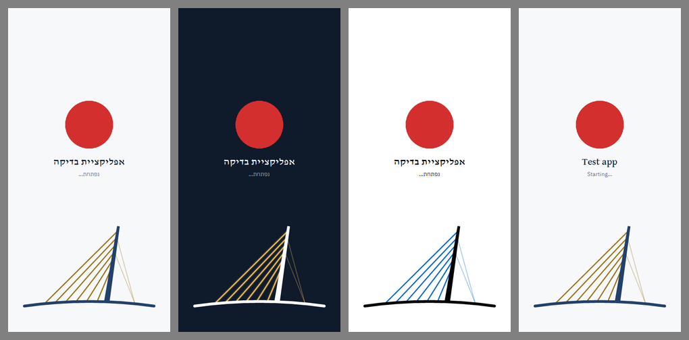
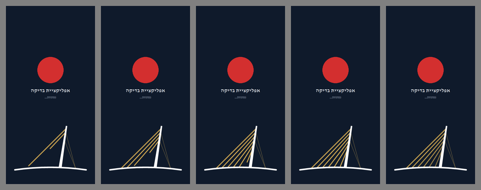
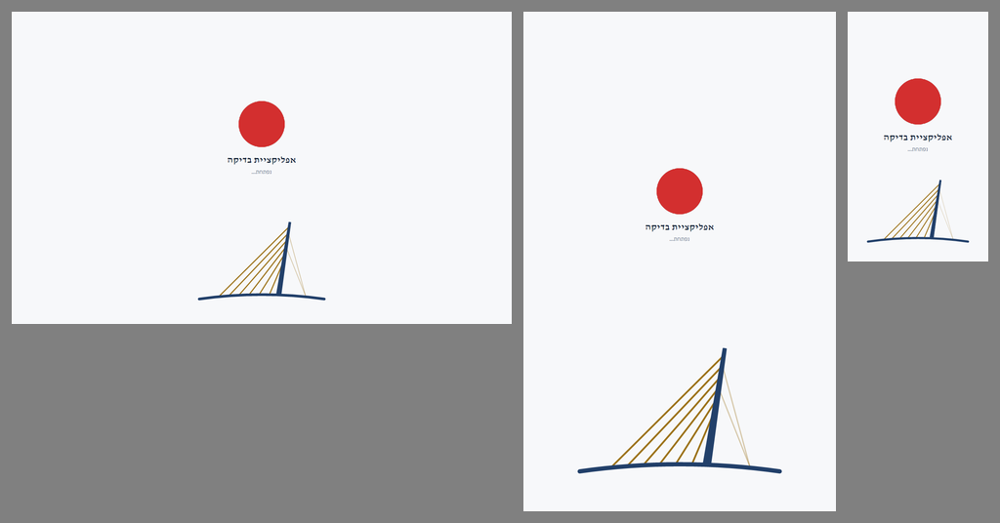

# תוכנית העיצוב — גשר המיתרים

> נכתבה לפי סקיל העיצוב (`.claude/skills/frontend-design`): תוכנית, בדיקה מול התדריך, בנייה, וביקורת עם צילומי מסך.

## התדריך

- **המוצר:** גשר המיתרים. מריץ אפליקציות אנדרואיד על Windows כחלונות רגילים.
- **הקהל:** ישראלים לא טכניים, עברית קודם, הרבה מהם ברשתות מסוננות (נטפרי, אתרוג). אנשים שצריכים את אפליקציית הבנק, מוביט, וואטסאפ, המזגן או המוזיקה שלהם על המחשב.
- **התפקיד העיקרי:** להתקין ולהפעיל אפליקציה בביטחון, ולהבין במילים פשוטות מה קרה כשמשהו לא עבד.
- **מקור השפה החזותית:** גשר המיתרים בירושלים. תורן לבן ונטוי, וכבלים שנפרשים ממנו כמו מיתרי הכינור של דוד המלך, באור הזהוב של ירושלים. המיתרים הם גם הרעיון של המוצר: חוטים מתוחים שמחברים שני עולמות.

## צבעים

| שם | ערך | תפקיד |
|---|---|---|
| שמי ירושלים | `#22406A` | צבע המותג: פס הכותרת, כפתור ראשי, קישורים. כחול עמוק של שחר, לא כחול Windows |
| זהב ירושלים | `#D9A43B` | **המיתרים בלבד**: באייקון, בפס הכותרת ובמסך הפתיחה, ועוד סימון "פעיל". לא לטקסט (ניגודיות נמוכה על לבן) |
| כבל | `#F7F8FA` | משטח בהיר ראשי, לבן קריר של הפלדה |
| אבן | `#EDE4D3` | משטח חם משני, רק לבחירה ולהדגשה. לא רקע |
| פלדה | `#55657B` | טקסט משני, קווים ומסגרות. כוילה מ-`#5A6A80` כדי לעבור 4.5:1 גם על שורה נבחרת (אבן) |
| דיו | `#142338` | טקסט ראשי. במצב כהה הרקע הוא `#0F1A2B` (כחול-לילה, לא שחור אפור) |

**ניגודיות:** דיו על כבל, ולבן על שמי ירושלים, מעל 8:1. זהב ירושלים משמש רק לקישוט, לעולם לא כטקסט על רקע בהיר. **למיתרים ולנקודת "פועלת" על רקע בהיר משמש זהב עמוק, `#9C7219` ‏(4.1:1)**, כי `#D9A43B` נותן שם רק 2.1:1. במצב ניגודיות גבוהה של Windows הכל עובר לצבעי המערכת.

**המקור:** כל הערכים, כולל המצב הכהה, נמצאים ב-[`ui/tokens.json`](../../../ui/tokens.json). המחולל בודק בכל הפקה 21 זוגות ניגודיות בשני המצבים.

## גופנים

| גופן | תפקיד | למה דווקא הוא |
|---|---|---|
| **David Libre** | סימן המילים, כותרות מסכים, מסך הפתיחה | גרסה חופשית (OFL) של "דוד", הגופן העברי הקלאסי של ישמעאל דוד. דוד הוא גם בעל הכינור שהמיתרים שלו נתנו לגשר את שמו |
| **IBM Plex Sans Hebrew** | כל טקסט הממשק | גופן מהונדס ומדויק, כמו גשר. קריא מאוד בעברית בגדלים קטנים, ומטפל טוב בשמות חבילות לועזיים |

- **גיבוי:** Segoe UI, שתומך בעברית בכל Windows. המתקין (Inno Setup) משתמש בו תמיד, כי Inno לא מאפשר גופן מוטמע.
- **התקנה:** הגופנים יושבים ב-`tools/package/ui-fonts` ומותקנים ל-`{app}\ui-fonts`. כל תוכנה טוענת אותם לתהליך שלה בלבד, בלי להתקין גופן במערכת. ב-GDI משקל Medium הוא משפחה נפרדת (`David Libre Medium`), וב-WPF הוא משקל 500 של `David Libre`. הטוקנים שומרים את שני השמות, והמחולל בודק אותם מול הקובץ.
- **סולם (לפי Bringhurst):** 12 להערות, 14 לגוף, 16 לכותרות רשימה, 21 לכותרות אזור, 24 לכותרת מסך (David), 36 או 48 לסימן המילים.
- **שורה:** 1.5 לגוף. אורך שורה עד כ-70 תווים.

## פריסה

**עיקרון:** מימין לשמאל כבסיס. הטקסט מיושר לימין. שמות חבילות, נתיבים ומספרי גרסה מבודדים משמאל לימין.

### מרכז הבקרה

```
┌──────────────────────────────────────────────────────────────┐
│                         ╱│ גשר המיתרים              ● פועל   │  ← כותרת: התורן והמיתרים
│                    ╱╱╱╱  │                                    │    (האלמנט הבולט היחיד)
├──────────────────────────────────────────────────────────────┤
│ [ התקנת אפליקציה ]                     [ חיפוש אפליקציה     ] │
├───────────────────────────────┬──────────────────────────────┤
│  ‏<מוביט>                       │ [סמל]  מוביט              ▸  │
│  com.tranzmate                 │        פועלת                  │
│  ─────────────                 │ [סמל]  זינג                  │
│  [ פתיחה ]  [ הסרה… ]          │ [סמל]  בנק לאומי             │
│  הרשאות                        │  …                           │
│   ◉ מיקום   ○ מצלמה            │                              │
│  גישה מיוחדת                   │                              │
│   ○ כל הקבצים                  │                              │
├───────────────────────────────┴──────────────────────────────┤
│ [עדכונים]  [רשת]  [מצב המערכת]  [רופא ההפעלה]                  │  ← לשוניות תחתונות
└──────────────────────────────────────────────────────────────┘
```

- **רשימה, לא רשת כרטיסים:** שורה לכל אפליקציה, עם סמל, שם ומצב בעברית. הלוח של האפליקציה הנבחרת נפתח בצד שמאל.
- **חיפוש חי** מעל הרשימה, ו**מחוון הפעלה** בשורה ("נפתחת…"). אלה הדרישות מהעיצוב של Lev-Good.
- **פינות לפי תפקיד:** חלון 10, לוח 8, כפתור 6, תווית מצב עגולה לגמרי. אין רדיוס אחד לכל דבר.

### מסך הפתיחה (נבנה ב-25.11)

```
┌───────────────────────────────┐
│                               │
│          [אייקון מוביט]         │  ← האפליקציה שהמשתמש לחץ עליה
│             מוביט              │  ← David Libre Medium, 24
│            נפתחת…              │  ← מה קורה, Plex 14, פלדה
│                               │
│                  │╲            │
│           ╱╱╱╱╱╱ │ ╲           │  ← הגשר כקו אופק: המיתרים נמתחים אחד אחד
│   ═══════════════════════     │     (התנועה היחידה במוצר)
└───────────────────────────────┘
```

- **מה מוצג קודם:** האפליקציה, כי המשתמש לחץ על מוביט ולא על גשר המיתרים. הגשר מתחת הוא המחוון והחתימה, ואין סימן מילים.
- **שתי גרסאות נבדקו באב-טיפוס:** (א) הגשר כמחוון קטן מתחת לשם, ו-(ב) הגשר כקו אופק בתחתית. גרסה א נראתה כמו סמל טעינה מקושט. בגרסה ב, בחלון רחב, הגשר כיסה את האפליקציה, ולכן הגובה שלו מוגבל ל-28% מהחלון והוא ממורכז.
- **התנועה:** המיתרים נמתחים מהתורן אל המסלול, אחד כל 140 אלפיות שנייה, נשארים 0.7 שנייה ונאספים בסדר הפוך. מחזור של 2.5 שניות.
- **מצבים:** בהיר; כהה, עם זוהר זהוב עדין על המיתרים; ניגודיות גבוהה, בצבעי המערכת בלבד; הפחתת תנועה, שבה המיתרים מלאים ובלי תנועה. צבע הכותרת של החלון לפי המצב.
- **מימוש:** ‏`compat/shell/splash_paint.cc`, ב-GDI+ עם קווים חלקים וציור ל-bitmap בזיכרון. בלי GDI+ נשאר הציור הקודם, כך שההפעלה לא תלויה בעיצוב. הצילומים על Windows נוצרים ב-CI (`hameitarim-design.yml`).

**הצילומים מ-Windows** (מצוירים ב-CI עם אותו קוד של המוצר):

| מצבים: בהיר, כהה, צבעי המערכת, אנגלית | התנועה: 0.2, ‏0.48, ‏0.82, ‏1.3 ו-2 שניות |
|---|---|
|  |  |



### דיאלוגים (הרשאה, מידע, קריסה)

כותרת ב-David Libre, הסבר קצר ב-Plex, ופעולה ראשית אחת ברורה. בהרשאה: "לאפשר מיקום" / "לא לאפשר". בקריסה: מה קרה, ומה עושים עכשיו.

## עקרונות

1. **עברית היא הבסיס,** ולא תרגום של ממשק אנגלי.
2. **בולטות במקום אחד:** מוטיב המיתרים מופיע באייקון, בפס הכותרת ובמסך הפתיחה, ובשום מקום אחר.
3. **שקט ומבנה:** רשימות ולא כרטיסים. קו מפריד רק כשהוא מפריד משמעות.
4. **אמת במצבים:** כל מצב אומר מה קורה ומה הצעד הבא. בלי "אופס", ובלי הודעה מעורפלת.
5. **שייכות ל-Windows:** מצב בהיר וכהה לפי Windows, ניגודיות גבוהה, מקלדת, ‏DPI, וכיבוד "הפחתת תנועה".

## בדיקה מול התדריך: מה תוקן ולמה

| טיוטה ראשונה | למה היא גנרית | התיקון |
|---|---|---|
| סגנון Fluent של Windows 11, ‏Segoe UI וצבע ההדגשה של המערכת | ככה נראית כל אפליקציה ב-Windows, וגם העיצוב הנוכחי (`#1570EF`) | גופנים עם סיבה (דוד, Plex), צבע מותג משלנו ומוטיב המיתרים |
| כחול כהה וזהב כצבעי ממשק | נראה כמו בנק או מותג יוקרה | הזהב מופיע רק כ"אור על המיתרים". הממשק עצמו לבן קריר ודיו |
| רשת כרטיסים של אפליקציות (כמו בעיצוב של Lev-Good) | ערכת הכרטיסים של SaaS: רדיוס אחיד וצל אחיד | שורות ברשימה ולוח פרטים, ו"פינות לפי תפקיד" |
| שורת תיאור מתחת לשם, עם מקף ארוך | אחד מסממני התבנית הגנרית | סימן מילים נקי. ההסבר מופיע רק במסך הריק של ההפעלה הראשונה |
| שורת סטטוס עם נקודות אמצע בין פריטים | סממן תבנית | כל נתון בשורה משלו, או לשוניות של ממש |
| מסך פתיחה עם הגשר כמחוון קטן מתחת לשם האפליקציה | נראה כמו סמל טעינה מקושט, כמו בכל אפליקציה | הגשר כקו אופק בתחתית החלון, בגובה מוגבל |


## סדר הבנייה

1. **האייקון** (`tools/icons/gesher-icon.cjs`): בגדלים 16–1024, עם רמת פירוט לפי גודל. **בוצע.**
2. **טוקנים** (`ui/tokens.json`, ‏`tools/ui/generate.py`): מקור אחד ל-WPF, ל-C, למתקין ולאבי-טיפוס. **בוצע.**
3. **מסך הפתיחה.** **בוצע** בקוד, ונבדק בצילומים על Windows ב-CI.
4. **מרכז הבקרה** (אחרי גל 1), **הדיאלוגים** (אחרי #290 ו-#362) **והמתקין**, לפי הסדר בתוכנית העבודה (שלב 5).
